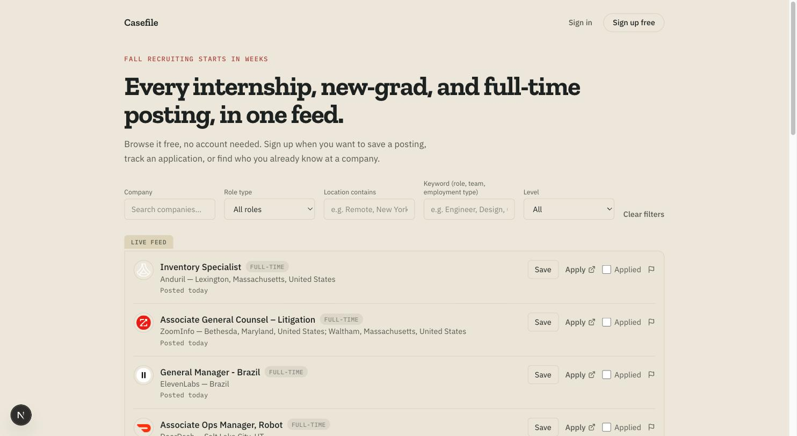
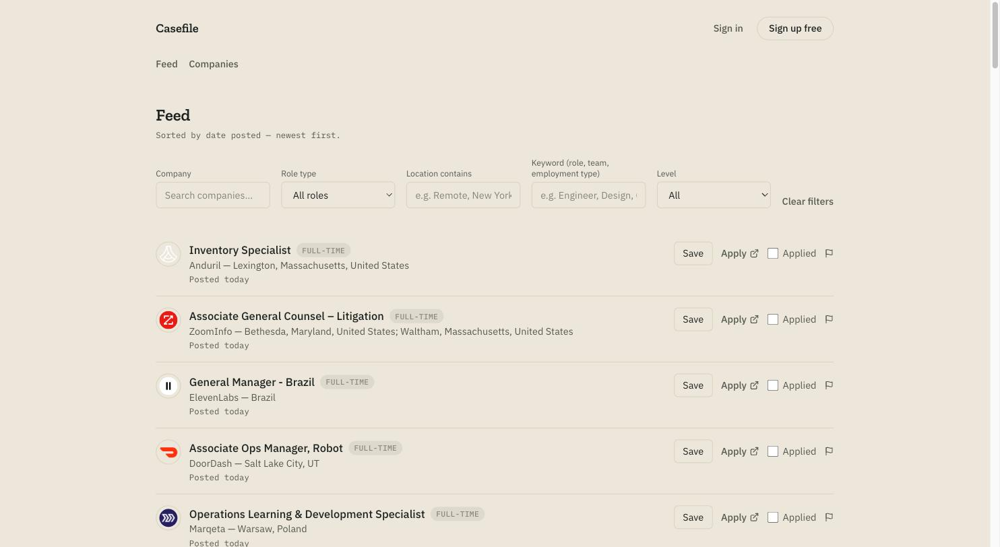
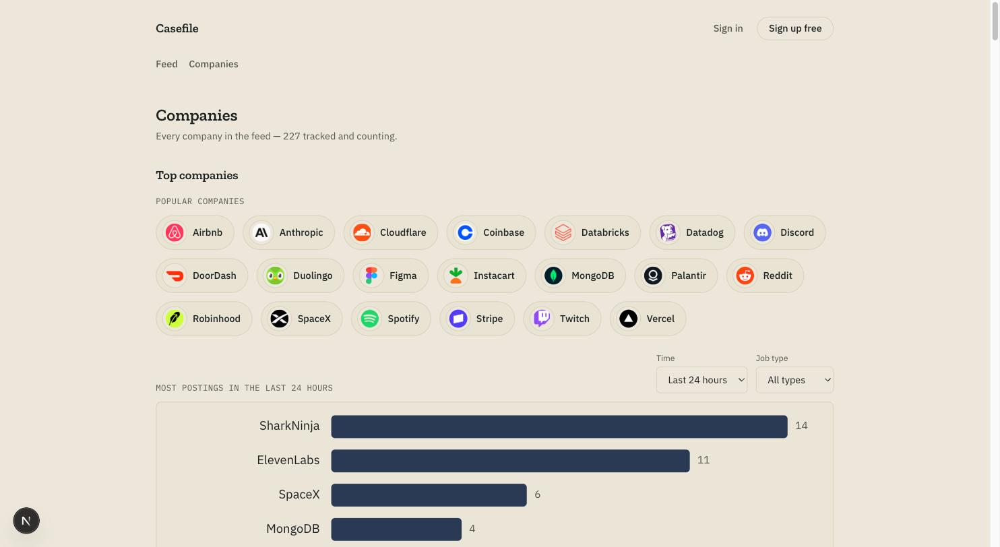

# Casefile

**Every internship, new-grad, and full-time posting, in one feed — plus the
tracker to go with it.**

A free job-search tracker: a public, searchable feed of postings scraped
straight from company career pages, an application tracker with a funnel
view, and a networking tracker for the contacts and referrals behind each
application.

## Content engine (marketing automation)

`scripts/content-engine/` runs a daily pipeline for a faceless TikTok
account promoting the app — AI-drafted slideshow copy grounded on real
Supabase posting data, rendered into ready-to-upload images. Runs locally
(not deployed), scheduled via two `launchd` jobs already installed on the
dev machine:

- **8:00am** — `generate.ts` drafts copy for 3 posts (tactical advice,
  networking tactics, CTA), avoiding hooks used in recent batches, and
  emails you the draft (via Mail.app — no third-party email service) with
  each slide's exact photo filename.
- **Your review window** — edit `content/output/<date>/draft.json`
  directly, or use `/admin/content` in the live app (syncs through a
  `content_drafts` Supabase table — editing there is optional; if you never
  touch it, the local file is used as-is).
- **8:30am** — `render.ts` renders the (possibly edited) draft into slide
  images and emails you the previews. Posting to TikTok stays manual.

Local-only asset library lives in `content/assets/` (photos, gitignored —
not committed). See `scripts/content-engine/*.ts` for the individual
steps; each can be run manually with `npx tsx scripts/content-engine/<script>.ts`.

## Screenshots

|                                Live feed preview                                |                              Full feed                              |
| :-------------------------------------------------------------------------------: | :---------------------------------------------------------------------: |
|  |  |

## What it does

- **Public feed** (`/feed`) — no account needed. Filter by company, role
  type, location, keyword, or level.
- **Companies directory** (`/companies`) — every tracked company, posting
  activity over time, split by internship vs. full-time.
- **Application tracker** (`/applications`) — funnel view (applied → OA →
  interview → offer/rejected), manual entries, and recommendations inferred
  from your own application history.
- **Networking tracker** (`/contacts`) — log contacts and referrals as a
  tree (who introduced whom), with follow-up reminders.
- **Automated multi-ATS scraping** — daily sync across Greenhouse, Lever,
  and Ashby boards, plus a community-maintained feed for everything else.
- **Broken-link review queue** — automated dead-link checks and
  user-reported flags feed one admin queue.

## Setup

1. `npm install`
2. Copy `.env.example` to `.env.local` and fill in:
   - **Supabase** — create a project at https://supabase.com/dashboard, copy
     the project URL and service-role key.
   - **Clerk** — create an app at https://dashboard.clerk.com, copy the
     publishable and secret keys. See "Account deletion" below for the
     webhook signing secret.
   - **Postmark** (not yet built) — create an inbound server at
     https://postmarkapp.com for forwarded application/networking emails.
   - **Groq** (not yet built) — get an API key at https://console.groq.com;
     meant to run open-weight models for parsing forwarded emails instead of
     hand-written per-ATS regex rules.
3. Run the schema migrations against your Supabase project, in order:
   `supabase/migrations/0001_init.sql` through the highest-numbered file
   (paste each into the Supabase SQL editor, or apply via the Supabase CLI —
   `mcp__supabase__apply_migration` if you're using Claude Code with the
   Supabase MCP server, see `.mcp.json`).
4. `npm run dev` and open http://localhost:3000.

## Structure

- `src/app/page.tsx` — public landing page: a live, searchable top-10 feed
  preview, no account needed.
- `src/app/(dashboard)/feed`, `.../companies` — public, unauthenticated
  postings/company browsing. Saving, applying, and reporting a broken link
  redirect anonymous visitors to sign-up instead of erroring.
- `src/app/(dashboard)/applications`, `.../contacts`, `.../profile`,
  `.../dashboard` — gated by Clerk middleware (`src/proxy.ts`).
- `src/app/api/inbound-email` — Postmark webhook target (stub; not built).
- `src/app/api/sync-postings` — scraper entrypoint, see "Scraping" below.
- `src/app/api/webhooks/clerk` — account-deletion cleanup, see below.
- `src/lib/supabase.ts` — service-role Supabase client, server-side only.
- `src/lib/scrapers/` — one fetcher per ATS (`greenhouse.ts`, `lever.ts`,
  `ashby.ts`), a community-feed sync (`community.ts`), dead-link checking
  (`linkcheck.ts`), and the scrape-target list (`companies.ts`).
- `supabase/migrations/` — schema, applied in order; no down-migrations.

## Scraping

`POST`/`GET /api/sync-postings` runs the Greenhouse/Lever/Ashby scrapers, the
community-listings sync, and dead-link checking. `vercel.json` schedules this
daily via Vercel Cron, which automatically sends the `CRON_SECRET` env var as
an `Authorization: Bearer` header — set `CRON_SECRET` in the Vercel project's
env vars to match `.env.local`. Vercel's Hobby tier caps cron jobs to one
run/day; tighten the schedule in `vercel.json` if you're on Pro.

Adding a company to scrape means editing `src/lib/scrapers/companies.ts`
(`SEED_COMPANIES`) and redeploying — it's a hardcoded list, not DB-driven.
Verify a board resolves before adding it:

- Greenhouse: `https://boards-api.greenhouse.io/v1/boards/{token}/jobs`
- Lever: `https://api.lever.co/v0/postings/{token}?mode=json`
- Ashby: `https://api.ashbyhq.com/posting-api/job-board/{token}`

## Broken link reports

Reporting a posting flags it (`reported_broken_at`) but doesn't hide it —
`is_active` alone controls visibility, so one report can't take a live
posting down for everyone. Flagged postings queue up at `/admin/reports`
(visible only to `ADMIN_EMAIL`, also linked from the dashboard nav for that
account) with "Confirm broken" (hides it) / "Dismiss" (clears the flag)
actions. Reporting also emails `ADMIN_EMAIL` via Postmark if
`POSTMARK_SERVER_TOKEN`/`POSTMARK_FROM_EMAIL` are set — silently skipped
otherwise.

## Account deletion

`/api/webhooks/clerk` handles Clerk's `user.deleted` event and removes the
user's rows from `applications`, `contacts`, `saved_postings`,
`saved_companies`, `user_preferences`, and `saved_filters` (`status_history`
and `interactions` cascade-delete automatically via their FKs). Set up in
Clerk's Dashboard → Webhooks → add endpoint pointing at
`/api/webhooks/clerk`, subscribed to `user.deleted`, and copy the signing
secret into `CLERK_WEBHOOK_SIGNING_SECRET`.

## Status

Live: the public feed/companies browsing, application tracker with funnel
view, networking/contacts tracker with referral graph, profile + saved
search presets, and automated multi-ATS scraping.

Not yet built: the Postmark/Groq forwarded-email auto-tracking described in
the original product plan. The `inbound-email` route and `GROQ_API_KEY` env
var are scaffolded for it but nothing calls Groq yet.

Before a full public launch, see the production-readiness assessment for
the remaining gaps (Clerk production keys, rate limiting, monitoring).
